<!-- Generated by scripts/build.py from live GitHub data. Edit scripts/, not this file. -->

<!-- Paired windows share a line with nothing between them and every image is top-aligned,
     so the dark backgrounds join into one surface. -->

  
  
  
  
  

  
  
  
  
  

Text version, with links

**Working on**

- [DailyDash](https://github.com/T3lluz/DailyDash): Android dashboard: health, weather, F1, GitHub and servers on one screen
- [omarchy-batteries](https://github.com/T3lluz/omarchy-batteries): Every battery in the Omarchy bar: the laptop (rate, time left, health, history), AirPods bud by bud, mouse, keyboard, headset, controller, phone. Pick what the bar shows.
- [omarchy-sonus](https://github.com/T3lluz/omarchy-sonus): Sonar-style PipeWire mixer in the Omarchy bar: Game, Chat, Media and Aux channels, drag-and-drop app routing, and a 10-band EQ per channel.
- [omarchy-rog-deck](https://github.com/T3lluz/omarchy-rog-deck): Omarchy bar widget and control panel for ASUS ROG laptops: animated power modes, temps and fans, keyboard lighting with auto-off, AniMe Matrix, FN-lock, battery limit, GPU mode.

**Pull requests elsewhere**

- [justrach/nanolight](https://github.com/justrach/nanolight/pull/28): Linux: dark on a dark desktop, and a theme.json for the panel's colors, corners and font (merged)
- [justrach/nanolight](https://github.com/justrach/nanolight/pull/11): The panel takes its new height on Wayland (merged)
- [omacom/omarchy](https://github.com/omacom/omarchy/pull/16956): Give the emoji picker categories, favorites, recents and skin tones (open)
- [sanjyay/wiggle](https://github.com/sanjyay/wiggle/pull/8): Fix double cursor on first enlargement and ignore shakes in games (open)
- [sanjyay/wiggle](https://github.com/sanjyay/wiggle/pull/7): Support touchpads and fix the cursor restore gap (merged)

**Stack**

- Languages, last 90 days: Kotlin, JavaScript, CSS, Python, QML, TypeScript
- Build: Android, Jetpack Compose, Ktor, Room, Supabase, Postgres, Qt Quick, Node.js, Playwright, WebExtensions, Quickshell, React, Vite, Tailwind, Deno, .NET, WinUI 3
- System: Linux, Arch, Omarchy, Hyprland, PipeWire, Docker, Tailscale
- Tools: Git, GitHub Actions, Gradle, Android Studio, Cursor, Claude Code, Hermes Agent, T3 Code

  Rebuilt every hour from the GitHub API by <a href="https://github.com/T3lluz/T3lluz/tree/main/scripts">scripts/build.py</a>.

